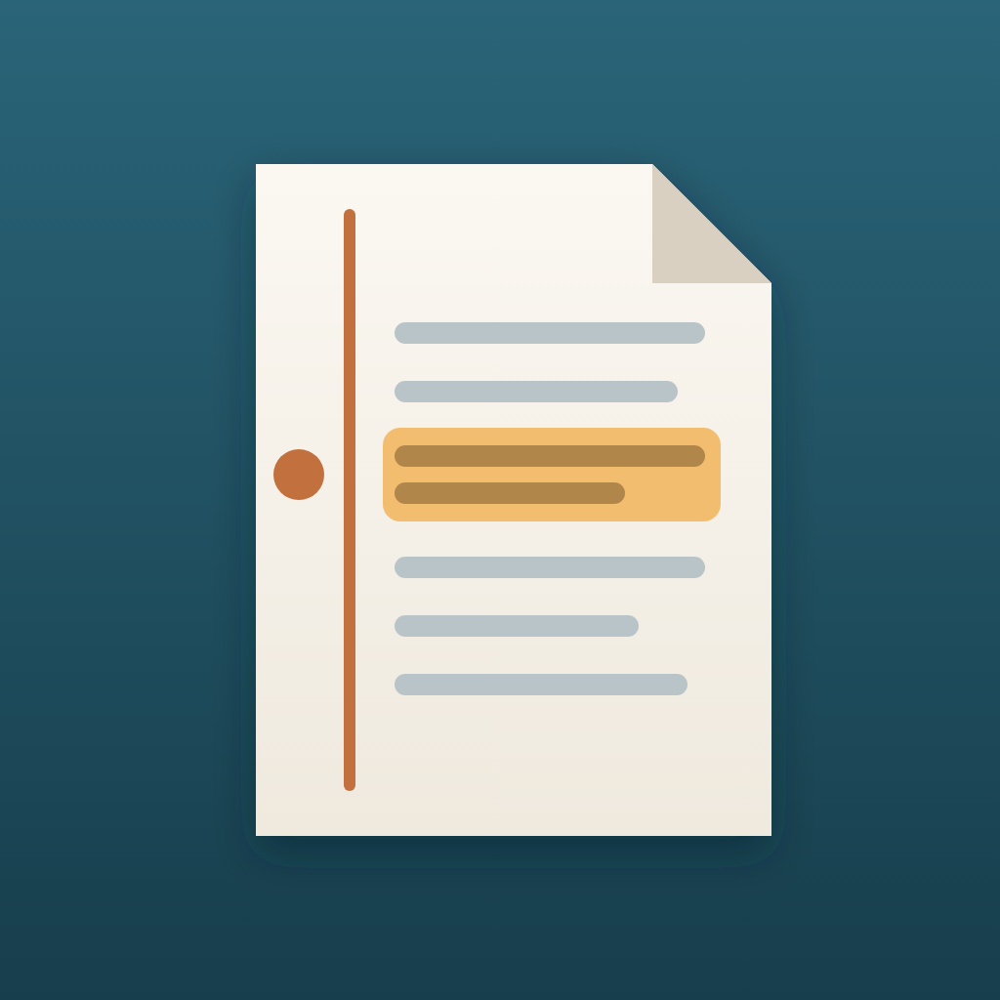

<p align="center">
  
</p>

<h1 align="center">Margins</h1>

<p align="center">A reference manager for Mac and iPhone: collect papers, read them comfortably on the phone,
highlight and annotate, search everything, and export citations.</p>

---

The library syncs between your Mac and iPhone through iCloud Drive.

## Features

- **Library:** add papers by DOI, link, PMCID or PDF (drag and drop on the Mac; share sheet on iPhone,
  from Safari, Mail or Files); metadata looked up from Crossref, Europe PMC, arXiv and OpenAlex, or read
  from the PDF's first page on-device; edit any field. Import from ReadCube Papers, BibTeX and RIS.
- **Organise:** folders with subfolders (drag papers and folders in the Mac sidebar), tags, stars,
  read/unread. **Smart folders** fill themselves from rules (words, tag, folder, year range, recently
  added, unread/starred, PDF or not, highlighted). Folders & Tags is one tap away on iPhone (swipe, long-press, or the reader's ⋯ menu). The iPhone
  library works like Mail: a list of places (all, starred, unread, New for You, folders, smart folders,
  tags), each opening its papers; swipe back from the left edge to return to the list. Tapping a paper
  opens its info page (abstract, folders, cite) with a **Read** button; delete a paper there, by
  swiping left or from its long-press menu. A paper found through New for You
  or Discover has **Read Paper** and **Show in Library** once added.
- **Read:** a reflowable reading view made from the paper (open-access XML from PMC/Europe PMC, arXiv's
  own HTML with real equations for arXiv papers, or the PDF itself) (large type on iPhone, zoomable figures, wide
  tables scroll in place) next to the original PDF. **Scroll or turn pages**: page mode lays the paper
  out as pages (two side by side on a wide Mac window); swipe or tap the edges on iPhone, arrow keys,
  space or a swipe on the Mac. Pinch to change the text size on iPhone. **Highlights and notes** in four colours; the
  **reading position syncs**, so a paper opens where you stopped on the other device.
- **Listen:** natural-voice narration (Kokoro) on the Mac and on the iPhone, following along in the text.
- **Clean up:** *Clean Up Library…* finds papers with missing or broken details (fixed from the DOI, or
  read from the PDF on the device), duplicates (merged, keeping tags, folders, highlights and the PDF), and
  reading views whose words ran together (remade).
- **Discover:** search 250 million papers on OpenAlex, add with one click, open what you added.
- **New for You:** a daily feed of new papers picked for your research. Describe your work in a few
  sentences (or let Margins draft it from your library). Each day it casts a wide net (OpenAlex
  searches written from your paragraph, papers citing recent ones in your library, authors you follow,
  and the last days of bioRxiv and medRxiv), ranks the candidates on the device with sentence
  embeddings against your interests, your library and your past Add / 👍 More Like This / Not for Me
  choices, and has the on-device model read the best abstracts (with the papers you thumbed up as
  examples), keep only clear matches and say why each one fits.
  Authors you follow and papers citing ones you watch always show up. Each paper gets a one-sentence
  summary, and the top of the feed has a short **In short** digest of all of it. One notification a day.
- **Cite:** APA, Vancouver, Nature, BibTeX, RIS, Markdown; share PDFs, EPUBs and citations. **Word and
  Google Docs add-ins** insert citations from the library and build the reference list.
- **Ask (✨):** an assistant that runs on the device: Apple Intelligence, or the open Qwen3 4B model where
  Apple Intelligence isn't available (e.g. iPhones in the EU). Ask about one paper (answers cite the
  passages, tap to jump there; it knows your highlights) or the whole library: find, compare and
  summarise papers, summarise a folder, find what's missing in it plus new papers that fill the gaps,
  and propose tags and folders for you to confirm. Conversations are kept for three days.
- **Agents:** an MCP server so Claude and other agents can search, read, cite and organise your library.

## Architecture

```
core/                  Rust: library storage + sync layout, metadata lookup (Crossref, Europe PMC,
                       arXiv, OpenAlex), open-access PDF finder, annotations, full-text search
                       (SQLite FTS5), BibTeX/RIS import and export, citations, EPUB reading
apple/MarginsCore/     Swift package wrapping the Rust core (generated by UniFFI)
apple/Paper2EpubKit/   Swift converter: paper (link, DOI, PDF, JATS XML) → reflowable EPUB, on-device
apple/Mac/             macOS app (SwiftUI): library, reader, browser-extension and citation endpoints
apple/iOS/             iPhone app
apple/ShareExtension/  iPhone share extension (PDFs, links, DOIs → the app via an App Group inbox)
apple/Shared/          code shared by the Mac and iPhone apps (reader, Ask, highlights, folders, …)
apple/citations/       Word add-in, Google Docs Apps Script and the formatting code they share
tts/                   Kokoro narration helper for the Mac (mlx-audio)
extension/             Chrome extension: save papers and PDFs from article pages
converter/             the original Python paper2epub tool (pandoc-based) and its Claude skill
design/                logo (SVG + 1024 px PNG)
scripts/build-core.sh  builds the Rust core for iOS, the simulator and macOS → XCFramework
```

### Library layout (sync-safe)

```
<library>/papers/<id>/paper.pdf     original PDF (if any)
<library>/papers/<id>/book.epub     reflowable version made by the converter
<library>/papers/<id>/fulltext.txt  plain text for search
<library>/ops/<device-id>.jsonl     append-only change log, one per device
<library>/positions/<device>.json   last reading position per paper (changes often, so not in the log)
<library>/smart-folders.json        smart folder rules
<library>/watches.json              watched authors, topics and citations
<library>/foryou.json               New for You: your interests, the feed, Add / More Like This / Not for Me feedback
```

Blobs are written once. Every change (metadata, read/starred, tags, collections, highlights and
notes) is an entry in the writing device's own log, so devices never write the same file and iCloud
never sees a conflict. Each device replays all logs (newest change wins) and keeps its own search
index in its cache folder.

### Reading: one paper, two views

Each paper keeps its **original PDF** and gains a **reflowable reading view** (the converted EPUB,
rendered in-app with WebKit). Both apps offer both views:

- iPhone: reading view by default (text reflows to the screen), PDF one tap away.
- Mac: PDF by default, reading view one tap away.

The reading view scrolls or turns pages (⋯ › Layout on iPhone, the book button or ⌥⌘P on the Mac).
Page mode cuts the page into screen-sized CSS columns (`apple/Shared/PageTurn.swift`); on iPhone the
web view's scroll view pages natively, so a page follows your finger. Contents, narration, highlights
and the synced reading position all turn to the right page.

There is no conversion back to PDF: the original PDF is kept, so nothing is lost. Highlights and
notes store the quoted text with a little context (`quote`, `prefix`, `suffix`) and a character offset,
so a highlight made on the phone finds the same words on the Mac whatever the screen width. Select text,
then **Highlight** / **Add Note** (right-click on the Mac, or ⇧⌘H; the edit menu on iPhone). Tap a
highlight to change its colour or note; *Highlights & Notes* lists them and copies them as Markdown.

## AI agents (MCP)

Margins ships an [MCP](https://modelcontextprotocol.io) server, `margins-mcp`, inside the Mac app, so AI agents can work with
your library: Claude Code, Claude Desktop, Cursor or any MCP client. Connect one with **Margins › Connect AI Agents…**, or by hand:

```sh
claude mcp add --scope user margins -- /Applications/Margins.app/Contents/MacOS/margins-mcp
```

Tools: `search_papers`, `list_papers`, `get_paper`, `read_paper` (full text, or the passages matching a query), `cite`
(APA, Vancouver, Nature, BibTeX, RIS), `library_overview`, `find_new_papers` (OpenAlex), `add_paper`, `find_pdf`,
`tag_papers`, `add_to_collection`, `set_status`, `add_note`, `update_paper`.

The agent writes through its own change log (`ops/agent-….jsonl`), exactly like another device, so it can work while the
apps are open and its changes sync to the Mac and iPhone. The same binary is a command-line tool:

```sh
margins search csf lactate
margins read <id> "how many patients"
margins cite <id> <id> --style vancouver
margins path <id> pdf
```

Inside the apps, **Ask** (✨) runs a small agent on the device with the same kind of tools: Apple's
on-device model, or Qwen3 4B (4-bit, via MLX; a one-time 2.3 GB download) when Apple Intelligence is off
or unavailable. Pick the model in the panel's ⋯ menu.

## Citations in Word and Google Docs

**Margins › Citations in Word & Google Docs…** sets them up. Both talk to the Mac app over
`https://localhost:47481` (a certificate made for this Mac only; trusting it needs your password once).

- **Word:** *Install in Word*, restart Word, then **Cite** on the Home tab. Search, pick papers, *Insert
  Citation*; *Insert Bibliography* where the references go; *Update All* after edits or a style change.
  Citations are content controls tagged with the paper ids, so they survive editing and renumber.
- **Google Docs:** Extensions › Apps Script; paste `Code.gs` and an HTML file `Sidebar` (both copied from
  the Margins window; the sidebar carries a pairing key), reload, then **Margins › Cite…**.

Styles: APA 7, Vancouver, Nature. Margins must be open while you cite.

## Build

```sh
brew install rustup xcodegen && rustup default stable
rustup target add aarch64-apple-ios aarch64-apple-ios-sim aarch64-apple-darwin
./scripts/build-core.sh                # Rust core → XCFramework + Swift bindings
cd apple && xcodegen generate && open Margins.xcodeproj   # set your own DEVELOPMENT_TEAM in project.yml
```

Tests:

```sh
cd core && cargo test                  # core tests (cargo test -- --ignored for online lookups)
cd apple/MarginsCore && swift test     # Swift ↔ Rust round trip
```

### Browser extension

Chrome → `chrome://extensions` → Developer mode → Load unpacked → `extension/`. The Margins Mac app
must be running; the extension talks to it on `127.0.0.1:47480` (extension requests only).

## Roadmap

1. ✅ Rust core + Swift bindings
2. ✅ Mac app: library, search, import (ReadCube Papers / BibTeX / RIS / PDF folders), Find PDF,
   continuous reading view + PDF view, citations
3. ✅ Chrome extension
4. ✅ iPhone app, share extension, iCloud Drive sync
5. ✅ Highlights and notes, synced reading position
6. ✅ Ask (on-device assistant) and MCP server for agents
7. ✅ Citation add-ins: Word and Google Docs
8. ✅ Duplicate and metadata cleanup, smart folders
9. ✅ New-paper alerts
10. ✅ arXiv HTML reading views (arXiv HTML, ar5iv, then PDF)
11. ✅ Page-turning reading view

## License

MIT, see [LICENSE](LICENSE).
