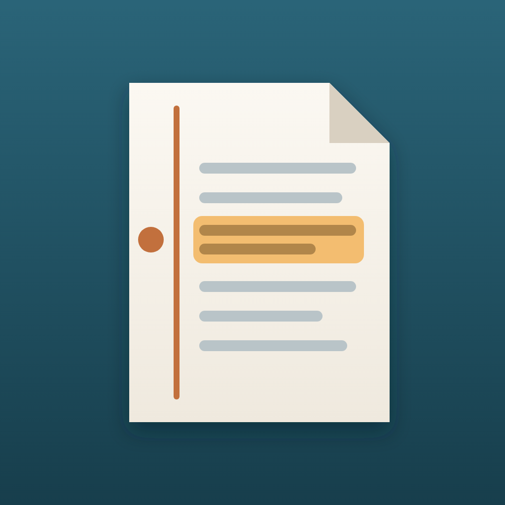

  

<h1 align="center">Lunta</h1>

<strong>Reader and reference manager for scientific papers.</strong> 
Mac · iPhone · iPad · Android · Windows · Linux

<em>Lunta</em> is Swedish for a thick bundle of papers.

---

Lunta turns every paper into a clean reading view that fits your screen, keeps your highlights and notes in
sync across your devices, and helps you find what to read next. Your library stays in your own iCloud or
Google Drive: no account, no server, nothing collected.

## Download

**[Latest release](https://github.com/christoffermattssonlangseth/lunta/releases/latest)** for Mac, Windows,
Linux and Android (the release page says which file you need), plus the browser extension. iPhone and iPad:
**[Lunta on the App Store](https://apps.apple.com/app/lunta/id6835403752)**.

Lunta updates itself on Mac, Windows, Linux (AppImage) and Android: once a day it asks GitHub whether
there is a newer version and offers to install it (**Check for Updates** is in the Lunta menu on the Mac,
under Settings elsewhere, where the daily check can be turned off). The Linux .deb is updated by
downloading the new one; Lunta says when there is one. Lunta 1.0.5 and earlier don't update themselves:
download the newest version once more by hand.

**New to Lunta?** Start with **[Getting started](https://christoffermattssonlangseth.github.io/lunta/getting-started.html)**:
which setup fits your devices, and how to move your library from Zotero, Mendeley, ReadCube or EndNote
([step-by-step import guide](docs/importing.md)).

## What it does

- **Read:** each paper becomes a reflowable reading view, with tappable figures and citations, real
  equations, themes, and scroll or page turning. The PDF is one tap away. Click a citation, in the reading
  view or the PDF, to see the reference and add it to your library.
- **Highlight and note:** four colours, a highlight mode for marking quickly, Apple Pencil on iPad. Highlights
  sync everywhere and are searchable.
- **Library:** add papers by DOI, PubMed ID, arXiv link or PDF, or straight from your browser with the
  [Lunta extension](#browser-extension-and-add-ins) (Chrome, Edge, Firefox, Safari). Lunta finds legal
  open-access PDFs (also from PubMed pages), and never swaps a published paper for its preprint. Folders, tags, Smart Folders,
  stars and a Must Read list, with full-text search.
- **New for You:** every morning, new papers picked for your research, with a short summary. Add your ORCID
  iD and it also learns from your own papers and shows new papers citing them.
- **Listen and ask:** papers read aloud in a natural voice (Kokoro, on every platform: the paragraph being read
  follows along, and it keeps playing from the lock screen), and an assistant that answers questions about a
  paper or your library, both running on your device.
- **Cite:** 12 citation styles and ~10,000 journal styles, BibTeX and RIS, citing in Word and Google Docs, and for LaTeX fixed
  citation keys and a .bib file that keeps itself up to date.
- **Agents:** an [MCP server](docs/development.md#ai-agents-mcp) so Claude and other AI agents can search,
  read, cite and highlight in your library.

## Browser extension and add-ins

### Browser extension: Chrome, Edge, Firefox (Mac, Windows, Linux)

Saves the paper you're looking at to Lunta, with its PDF, using the access your browser already has (your
institution's subscription, for example). On a journal's article page, **Use this page's full text** turns
the page you're reading into the paper's reading view. On PubMed, **Find PDF** gets a free, legal copy.
It works in Chrome, Edge, Brave and other Chromium browsers, and in Firefox.

**Chrome Web Store and Firefox Add-ons:** submitted, in review. Once they're approved, installing is one
click (and updates come by themselves); the links will be here. Until then, install it from the release:

1. Download **`Lunta-…-Chrome-Extension.zip`** from the
   [latest release](https://github.com/christoffermattssonlangseth/lunta/releases/latest) and unzip it.
   Keep the folder somewhere permanent (Chrome loads the extension from it).
2. Open **`chrome://extensions`** (Edge: `edge://extensions`) and turn on **Developer mode** (top right).
3. Click **Load unpacked** and choose the unzipped folder.
4. Pin it: click the puzzle piece in the toolbar, then the pin next to **Lunta**.

**Firefox:** the same zip. Until Lunta is in Firefox Add-ons, open `about:debugging` › **This Firefox** ›
**Load Temporary Add-on…** and choose the zip (Firefox removes it when it restarts).

Lunta must be open on the same computer: the extension talks only to the app, never to a server. To update,
unzip the new version over the old folder and click ↻ on the extension in `chrome://extensions`.

### Safari (Mac, iPhone, iPad)

The extension comes with the Lunta app, so there's nothing to download:

- **Mac:** open Lunta once, then in Safari choose **Safari › Settings › Extensions**, tick **Lunta** and
  allow it on all websites. It works like the Chrome extension (Lunta must be open).
- **iPhone and iPad:** in the **Settings** app, **Apps › Safari › Extensions › Lunta**: turn it on and
  allow it on all websites. On an article page, open Safari's extensions menu (the puzzle piece, or **aA**)
  and choose **Lunta**. What you save goes straight to Lunta on the same device; open Lunta to finish
  (the panel has an **Open Lunta** link).

**Android:** there are no extensions in Chrome for Android. Instead, open a paper's **Journal page** in Lunta,
sign in there if needed, and tap **Use this page's full text**.

### Word and Google Docs

Cite from your library while you write: citations in 12 styles or any of ~10,000 journal styles, several papers
in one citation, a reference list that updates itself, and renumbering after edits. **Click a citation** to see
its papers, remove one or add more. Documents keep a copy of the papers they cite, so co-authors without your
library (and you, with Lunta closed) can still update them.

- **Word (Mac):** in Lunta, **Lunta › Citations in Word & Google Docs…** › **Trust Certificate** (your Mac asks
  for your password once) › **Install in Word**. Restart Word and open **Home › Add-ins › Lunta Citations** once;
  from then on **Cite** is on the Home tab. Lunta for Mac must be open while you cite.
- **Google Docs (Chrome, Edge, Firefox; with Lunta for Mac, Windows or Linux):** with the
  [browser extension](#browser-extension-chrome-edge-firefox-mac-windows-linux) installed, every Google Docs
  document has a **Lunta** button at the bottom right. Click it, **Connect Google account** (once), click in your
  text, search, **Insert Citation**. Google is still reviewing Lunta's access to Google Docs; until then it shows
  an "unverified app" warning: click **Continue**. The older Apps Script route (**Extensions › Apps Script**, the
  two files from Lunta's Citations window) keeps working, also in Safari.

**Write first, cite later.** Type a placeholder where a citation goes and keep writing: `(Langseth et al. 2025)`,
`(Langseth et al., 2025; Smith 2019)`, `[Langseth 2025 spatial]` (words after the year help find the paper) or
`{Langseth 2025}`. Then **Resolve Citations…** in the panel lists them, each with the papers Lunta proposes: from
your library first, else from Crossref. Lunta proposes, you decide: **Confirm** (or pick another, **Search…**,
**Skip**) one by one, or **Confirm All Exact Matches** for those with exactly one paper in your library that
fits. Only then does a placeholder become a citation (a paper not yet in your library is added to it), and the
reference list updates. Ordinary brackets like "(see Fig. 2)" or "(n = 2025)" are left alone.

More: [Lunta Citations](https://christoffermattssonlangseth.github.io/lunta/support.html).

### LaTeX and Overleaf

Every paper has a citation key (`Kukanja2024cellular`) that never changes on its own, also when you edit the
title or authors, and is the same on all your devices. You see it, and can change it, in the paper's details.

- **Copy \cite:** right-click papers, **Copy \cite{…}** (several papers: one `\cite{a,b,c}`). On iPhone and
  iPad it is in the paper's menu (touch and hold). The BibTeX entries use the same keys (**Cite › BibTeX**, or
  **Share**).
- **A .bib file that stays up to date (Mac, Windows, Linux):** right-click a folder or **All Papers**, **Keep
  BibTeX File Updated…**, and choose where to save it. Lunta rewrites the file whenever papers in the folder are
  added, removed or edited. To stop, right-click it again.
- **An existing LaTeX project:** **File › Import BibTeX (Keep Citation Keys)…** (Mac, or a folder's menu;
  on iPhone and iPad **+ › Import BibTeX (Keep Citation Keys)**) reads the project's .bib into a folder. Each
  entry is looked up (DOI, arXiv, Crossref) and keeps its key, so `\cite{…}` in the document keeps working;
  software and web pages are kept as written. Then keep the folder's BibTeX file updated and use it in the
  project. A report lists what was found and where the .bib and the published record differ.
- **Write first, cite later:** write `\cite{?langseth2025}` (or `\cite{langseth2025?}`; words after the year as
  hints: `\cite{?langseth2025spatial}`), `(Langseth et al. 2025)` or `[Langseth 2025 spatial]` where a citation
  goes. Then **File › Resolve Citations in a .tex File…** (Mac, or a folder's menu; Windows and Linux: **+** or a
  folder's menu) lists them with the papers Lunta proposes. Confirm or skip each one, choose the folder whose
  BibTeX file Lunta keeps, and **Write**: the papers go into that folder (added to your library if they weren't),
  the .tex gets their keys (`\cite{Langseth2025spatial}`), the original is kept as `.tex.bak`, and the .bib is
  updated. With Overleaf: download the project (or use its Git or Dropbox sync), resolve the .tex, upload it.
- **Entry types:** conference papers are `@inproceedings`, preprints `@misc` with the arXiv id, reports
  `@techreport`, and so on, as LaTeX users expect; titles in capitals come out in title case.
- **Overleaf:** save the .bib file in Dropbox and link the project to Dropbox, or in the project's Git
  repository (Overleaf's Git sync) and push. Without either, upload the .bib file to the project
  (**Upload › From your computer**) and upload it again when it changes.

### AI agents (MCP)

Claude and other AI agents can search, read, cite and highlight in your library through Lunta's MCP server:
see [docs/development.md](docs/development.md#ai-agents-mcp).

## Remaking reading views

Lunta's converters keep improving (for example, from 1.0.6 reference lists and tables in PDFs are found far
more reliably). A reading view is made once, when the paper is added, so older papers keep the view they got
then. To give a paper the latest one, on the Mac select it (or several, or ⌘A in a folder or tag) and
right-click › **Make Reading View**. The new view syncs to your other devices. Your highlights and notes are
kept and found again in the new text; any that can't be placed are marked in the paper's Highlights list.

## Sync

- **Mac, iPhone and iPad** sync through iCloud Drive, with nothing to set up.
- **Android, Windows and Linux** sync through a *Lunta* folder in Google Drive.
- **Both:** a Mac can bridge the two (**Lunta › Google Drive for Android…**).

## Help and development

- Questions, bugs and ideas: [GitHub Issues](https://github.com/christoffermattssonlangseth/lunta/issues).
- Privacy: [Lunta collects nothing](https://christoffermattssonlangseth.github.io/lunta/app-privacy.html).
- Building from source, architecture and sync design: [docs/development.md](docs/development.md).

## License

MIT, see [LICENSE](LICENSE).
